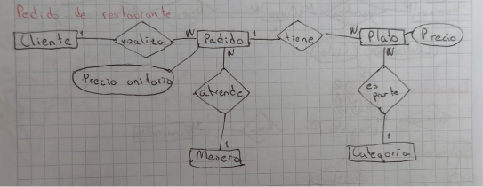

## 🍽️ Ejemplo 2: Pedidos de Restaurante

Los clientes realizan pedidos que contienen varios platos con distinta cantidad. Los platos se agrupan en categorías. Cada pedido lo atiende un único mesero. El precio del plato debe registrarse tal como estaba al momento del pedido, aunque luego cambie.

[Volver al inicio](AA1.md)