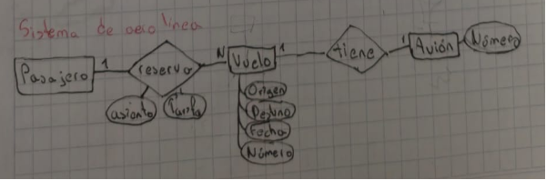

## ✈️ Ejemplo 4: Sistema de Aerolínea

Una aerolínea opera vuelos (cada uno con número, fecha, origen y destino), cada vuelo lo realiza un avión. Los pasajeros realizan reservas para un vuelo específico, indicando asiento y tarifa pagada en el momento de la reserva.

[Volver al inicio](AA1.md)