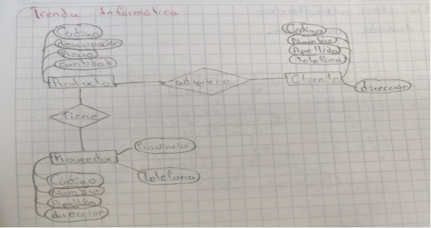

## 🖥️ Ejercicio 6: Tienda Informática

Se desea crear una aplicación para la gestión de una tienda informática. La tienda dispone de una serie de productos que se venden a los clientes. De cada producto informático se desea guardar el código, descripción, precio y número de existencias. De cada cliente se desea guardar el código, nombre, apellidos, dirección y número telefónico. Un cliente puede comprar varios productos en la tienda y un mismo producto puede ser comprado por varios clientes. Cada vez que se compre un artículo quedará registrada la compra en la base de datos junto con la fecha en la que se compró el artículo. La tienda tiene contactos con varios proveedores que son los que suministran los productos. Un mismo producto puede ser suministrado por varios proveedores. De cada proveedor se desea guardar el código, nombres, apellidos, dirección, provincia y número de teléfono.

[Volver al inicio](AA1.md)