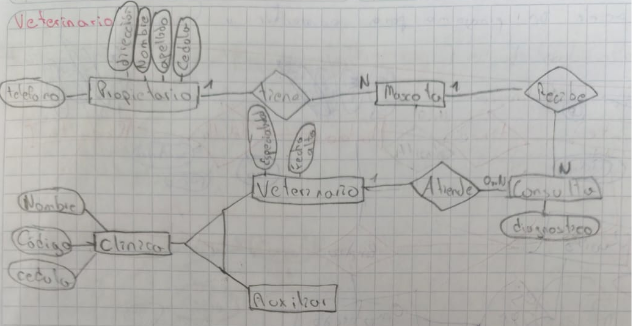

## 🐾 Ejercicio 9: Veterinaria

- 🧑 Del propietario interesa: cédula, apellidos, nombres, dirección, teléfonos
- 🐕 De la mascota interesa: identificador, nombre, fecha de nacimiento, tipo
- Un propietario puede llevar una o varias mascotas
- Una mascota la lleva uno y solo un propietario
- 👨‍⚕️ Del personal de la clínica veterinaria interesa un código, el cédula, nombre
- Entre el personal de la clínica se distingue a los veterinarios y los auxiliares, pudiendo haber otros tipos
  - 🩺 Del veterinario se guarda además su fecha_alta y especialidad
  - 📋 De los auxiliares interesa su base de cotización
- Las mascotas pasan consulta con los veterinarios. De manera que:
  - un veterinario puede pasar consulta a ninguna o a varias mascotas, y
  - una misma mascota de la clínica ha pasado consulta una o más veces en fechas diferentes con varios veterinarios.
  - Al pasar consulta se realiza un diagnóstico.
- 📞 Cada propietario tiene un familiar de contacto para casos de emergencia.
  - De este familiar interesa la cédula, nombre y teléfono.
  - Si el propietario se da de alta en la clínica veterinaria, el familiar ya no interesa.
  - El familiar es contacto de un solo propietario

[Volver al inicio](AA1.md)